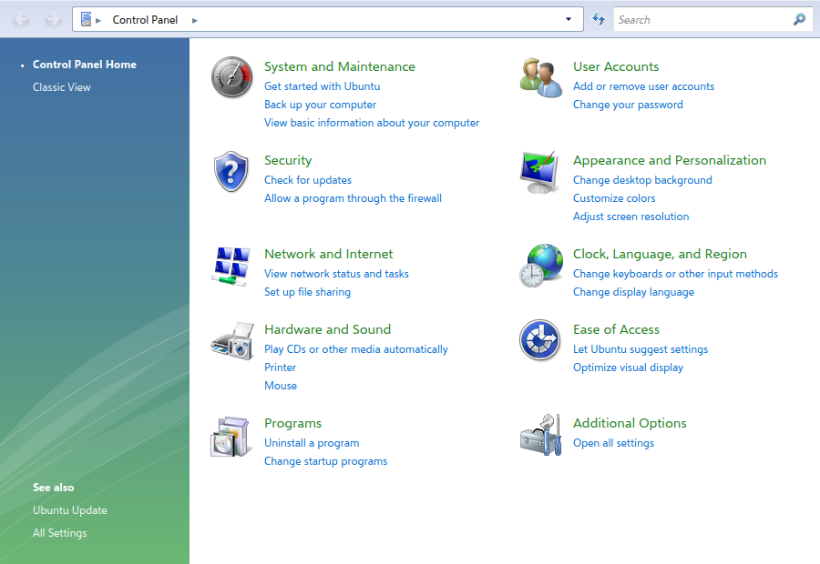
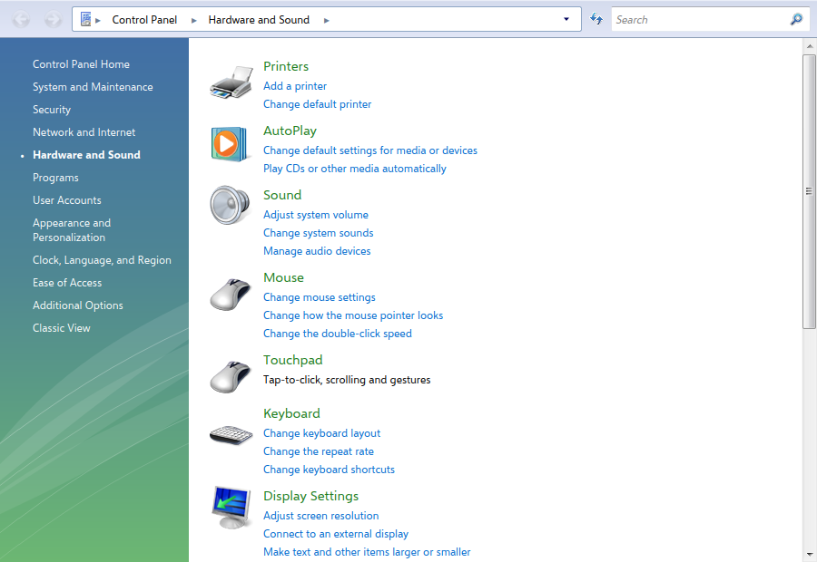
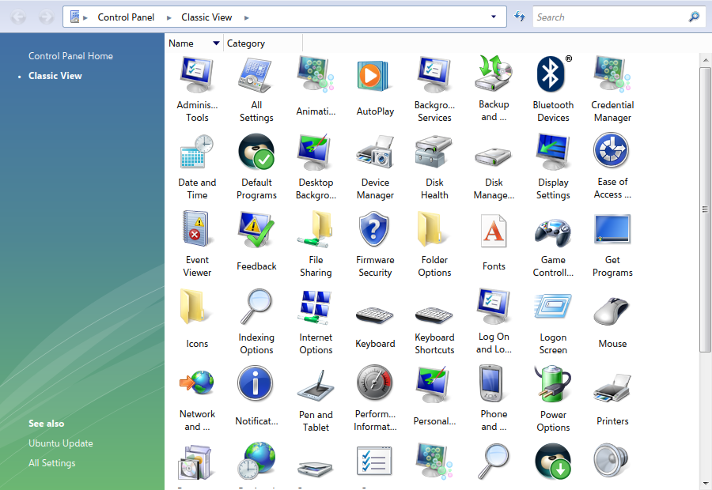
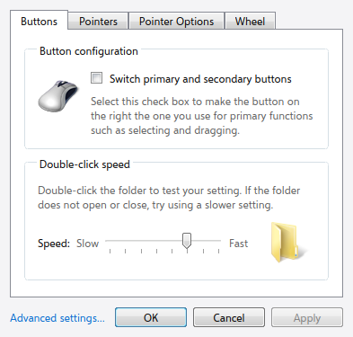
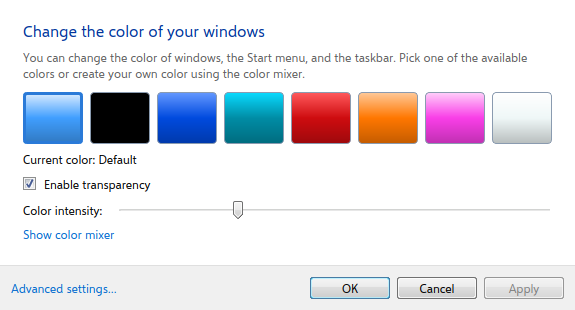
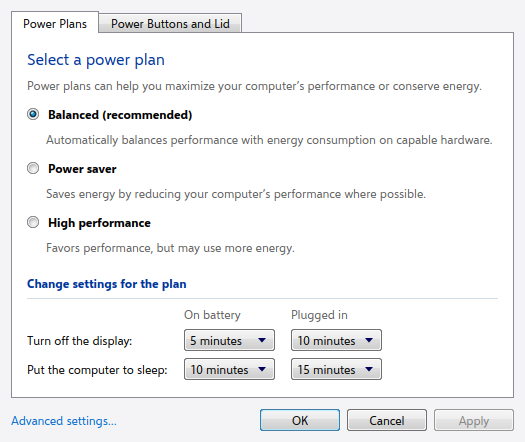

# Vista Control Panel

A Windows Vista style Control Panel for KDE Plasma on Linux. It has Vista's Category View,
Classic View, instant search, breadcrumbs, Back/Forward and task links, and its own settings
dialogs built like Vista's (Mouse, Power Options, Window Color, Sound, Network and Sharing
Center, User Accounts, …). These dialogs change the real KDE and system settings.

It pairs with [VistaThemePlasma](https://gitgud.io/aeroshell/vtp/vistathemeplasma), which makes
the Plasma desktop itself look like Vista. It also runs on a plain Plasma desktop.



| Category page | Classic View |
|---|---|
|  |  |

| Mouse | Window Color | Power Options |
|---|---|---|
|  |  |  |

## Features

- **Category View and Classic View**, with Vista's categories, task links and "See also" pane.
- **Instant search** over every task and setting, and **Recent Tasks** in the task pane.
- **Built-in settings dialogs**, all with Vista's OK / Cancel / Apply buttons. They write the same settings KDE does, so KDE's own System Settings always agrees:
  - AutoPlay
  - Date and Time
  - Default Programs
  - Desktop Background
  - Desktop Icon Settings
  - Display Settings
  - Folder Options
  - Keyboard
  - Mouse
  - Network and Sharing Center
  - Notification Area Icons
  - Personalization
  - Power Options
  - Programs and Features
  - Regional and Language Options
  - Screen Saver
  - Sound
  - System Properties
  - User Accounts
  - Window Color and Appearance
- **Everything else opens the matching KDE settings module** in its own window. The optional
  router can make "System Settings" links from other apps open the Control Panel instead.
- **AutoPlay**: asks what to do when you plug in a USB stick, camera or disc, as Vista does.
  It is off until you turn it on in the Control Panel.
- **Extensions**: drop a Python module into an extensions folder to add your own pages and
  links (see [`src/extensions/README.md`](src/extensions/README.md)).

## Requirements

- Python 3.10+ and PyQt6 (`python3-pyqt6` on Debian/Ubuntu/Fedora, `python-pyqt6` on Arch)
- KDE Plasma 6, including `kcmshell6`, `kreadconfig6`, `kwriteconfig6` and `kscreen-doctor`
- systemd tools: `hostnamectl`, `timedatectl`, `localectl`, `busctl`
- Optional, for some pages:
  - `nmcli` (NetworkManager) for networks
  - `pactl` (PipeWire or PulseAudio) for sound
  - `powerprofilesctl` for power plans
  - `pkexec` (polkit) for administrator changes
  - AccountsService for user accounts

## Install

```sh
git clone https://github.com/ChivanCOM/vista-control-panel.git
cd vista-control-panel
sudo ./install.sh                  # installs to /usr/local
vista-control-panel                # or find "Control Panel" in the menu
```

`sudo PREFIX=/usr ./install.sh` installs to /usr. `DESTDIR=… ./install.sh` stages it for a
package. `sudo ./install.sh --uninstall` removes it.

To try it without installing, run `python3 src/controlpanel.py` from the checkout.

### Command line

```text
vista-control-panel [page]              home | classic | sysinfo | <category>, e.g. hardware
vista-control-panel --applet <id>[#tab] open one dialog, e.g. --applet mouse
```

### Environment variables

| Variable | Effect |
|---|---|
| `VCP_OS_NAME` | Name shown for the system ("Get started with …"); defaults to `NAME` from os-release |
| `VCP_LOGO` | Icon name or image file for the System page; defaults to os-release `LOGO` |
| `VCP_AUTOPLAY` | `1` or `0` forces the AutoPlay agent on or off, whatever the setting says |
| `VCP_LIBDIR` | Where the launchers look for the program (set by `install.sh`) |

## Contributing

See [CONTRIBUTING.md](CONTRIBUTING.md) and the design guide in [docs/DESIGN.md](docs/DESIGN.md).

## Credits

- Written for **BOONE**, a personal Vista-style Ubuntu remix, and released as a standalone project.
- The Vista desktop look comes from [VistaThemePlasma](https://gitgud.io/aeroshell/vtp/vistathemeplasma)
  by the AeroShell project (catpswin56 and contributors).
- Companion project: [vista-dolphin](https://github.com/ChivanCOM/vista-dolphin), Dolphin
  as Vista's Explorer. Its command bar links to this Control Panel.

Windows and Windows Vista are trademarks of Microsoft. This project is not affiliated with
or endorsed by Microsoft.

## License

GPL-3.0-or-later. See [LICENSE](LICENSE).
